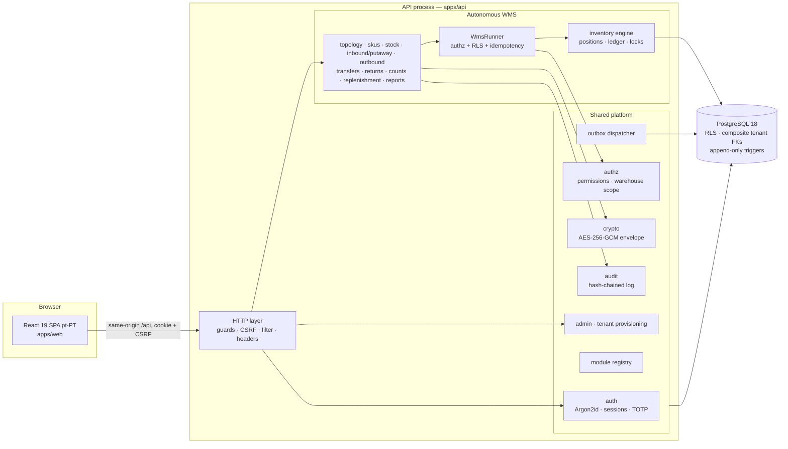

# Architecture — AutoLemon ERP v0.6.0

Owning module: platform. Status: implemented and tested for the scope in `docs/PROJECT_STATE.md`.

## 1. Shape: modular monolith

One deployable API process (NestJS 12 on Fastify 5) + one React SPA + one PostgreSQL database.
There are no microservices, brokers or Kubernetes requirements. Modules are separated by
**code boundaries and database ownership**, not by network hops (ADR-0001).



## 2. Bounded contexts and dependency rules

| Context                                              | Owns (tables)                                                                                                                                                                                                                                                     | May depend on                                          | Must not                                                   |
| ---------------------------------------------------- | ----------------------------------------------------------------------------------------------------------------------------------------------------------------------------------------------------------------------------------------------------------------- | ------------------------------------------------------ | ---------------------------------------------------------- |
| Platform (`apps/api/src/platform`)                   | companies, warehouses, users, user_permissions, sessions, mfa_*, one_time_tokens, auth_throttle, tenant_data_keys, security_audit_log, command_log, domain_outbox, doc_sequences                                                                                  | db, common, contracts                                  | import WMS code                                            |
| WMS (`apps/api/src/wms`)                             | skus, sku_barcodes, storage_nodes, containers, container_movements, stock_positions, inventory_transactions, inventory_ledger, reservations, inbound__, putaway_tasks, outbound__, transfers, transfer_lines, returns, return_lines, count_*, replenishment_rules | platform (authz, audit, crypto), db, common, contracts | be written to by any other module                          |
| Future modules (Sales, Purchasing, Finance, Catalog) | their own tables                                                                                                                                                                                                                                                  | WMS **application services** + versioned outbox events | write WMS tables, read decrypted secrets, touch auth state |

Rules enforced today: ESLint `no-restricted-imports` (since v0.6.0, `eslint.config.js`): platform,
db, common and config code cannot import `wms/` or `http/`; WMS code cannot import `http/` or any
platform package other than `authz/`, `audit/` and `crypto/`; the web client cannot import API
code or server-only modules; contracts cannot import applications. `tests/security/module-boundaries.test.ts`
proves the rules fire. The WMS inventory engine remains the only code that issues
`UPDATE stock_positions` / `INSERT inventory_ledger` (grep-able; reviewed). Future modules get
their own boundary block when created.

## 3. Request lifecycle (every protected call)

```mermaid
sequenceDiagram
  participant B as Browser
  participant G as AuthGuard
  participant C as Controller
  participant S as Service / WmsRunner
  participant P as PostgreSQL
  B->>G: POST /api/wms/w/{wh}/outbound/{id}/pick (cookie, X-CSRF-Token, Idempotency-Key, Origin)
  G->>G: Origin / Sec-Fetch-Site / X-Requested-With checks
  G->>P: session by SHA-256(token); idle+absolute expiry; user ACTIVE
  G->>G: CSRF token = HMAC(secret, sessionId) compare (constant time)
  G->>G: coarse authz: /api/admin/** ⇒ ADMIN; :wh ⇒ staff's own warehouse (before body parsing)
  G->>C: req.actor
  C->>C: Zod strict parse (unknown fields rejected)
  C->>S: pick(actor, wh, id, key, input)
  S->>S: requirePermission(wms.pick) — default deny
  S->>P: warehouseScope: staff must own wh; admin: wh ∈ company
  S->>P: BEGIN; set_config(app.company_id, app.wh_scope, local)
  S->>P: INSERT command_log (idempotency) ON CONFLICT…
  S->>P: SELECT … FOR UPDATE (reservation, line, position)
  S->>P: UPDATE stock_positions; INSERT inventory_ledger; INSERT domain_outbox
  S->>P: COMMIT
  S-->>B: 200 JSON (or replay of first result)
```

Failures map to JSON errors (`AllExceptionsFilter`): no stack traces; 403s and scope violations
are written to the security audit log in a separate transaction.

## 4. Module loading

`ENABLED_MODULES` is resolved by `platform/modules/registry.ts`. Only modules compiled into the
build can be enabled; unknown names abort startup. v0.5 contains only `wms` (core), so the
system always runs in **WMS-only mode** (acceptance scenario 12 is tested).

## 5. Data flow for inventory

1. Commands lock rows (`FOR UPDATE`, ordered by id) → no lost updates under concurrency.
2. `applyDelta()` updates the balance **and** appends the ledger row in the same statement pair.
3. Reconciliation (`reconcile()`, `reconcileReservations()`) proves balances = ledger and
   reserved = open reservations; exposed at `/stock/reconciliation`, asserted in tests and
   in `restore:smoke`.
4. Domain events go to `domain_outbox` in the same transaction; `OutboxDispatcher` publishes
   them per tenant (no subscribers in WMS-only mode).

## 6. Front end

React 19 SPA (hash router, no external router dependency — ADR-0007), Tailwind 4 tokens,
pt-PT strings, keyboard/scanner-first inputs. The SPA never stores tokens in web storage; the
CSRF token is kept in memory and re-derived from `/api/auth/session` after reload.

## 7. Where things are

| Path                                   | Content                                                             |
| -------------------------------------- | ------------------------------------------------------------------- |
| `apps/api/src/db/migrations`           | Hand-written, checksummed SQL migrations                            |
| `apps/api/src/composition.ts`          | Composition root (all service wiring)                               |
| `apps/api/src/wms/inventory/engine.ts` | Inventory engine and invariants                                     |
| `apps/api/src/http`                    | Controllers, guard, filter, hardening                               |
| `packages/contracts`                   | Zod DTOs, permission catalogue (shared with web)                    |
| `apps/web/src`                         | SPA                                                                 |
| `tests/`                               | integration, security, e2e suites + harness                         |
| `scripts/`                             | dev, test DB, e2e, security scan, backup/restore, handover, release |
| `infra/`                               | Production reference templates (NOT DEPLOYED)                       |
