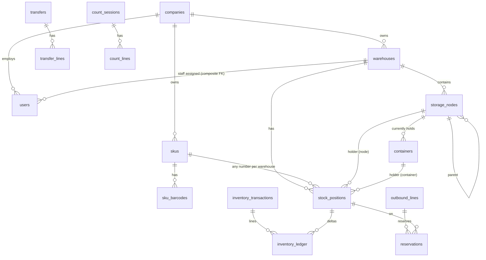

# Database — AutoLemon ERP v0.6.6

Owning module: platform/db. Engine: PostgreSQL 18 (target; Docker Compose) — the automated test
evidence in this build was produced on PostgreSQL **16.15** because the build environment could
not pull the 18 image (see `docs/PROJECT_STATE.md`). No 17/18-only features are used.

## 1. Migrations

| File                             | Content                                                                                                                                                                                                                                                                                                                                                           |
| -------------------------------- | ----------------------------------------------------------------------------------------------------------------------------------------------------------------------------------------------------------------------------------------------------------------------------------------------------------------------------------------------------------------- |
| `0001_platform.sql`              | runtime role, helper functions, companies, warehouses, users, permissions, sessions, MFA, one-time tokens, throttle, tenant DEKs, security audit log, idempotency log, outbox, document sequences                                                                                                                                                                 |
| `0002_wms.sql`                   | SKUs, barcodes, storage nodes (+ nesting trigger), containers (+ placement trigger), inventory transactions/ledger (append-only), stock positions (+ identity trigger), inbound, putaway, outbound, reservations, packages, transfers, returns, counts, replenishment                                                                                             |
| `0003_rls_and_grants.sql`        | least-privilege grants for `autolemon_app`, RLS policies                                                                                                                                                                                                                                                                                                          |
| `0004_passkeys_and_account.sql`  | `webauthn_credentials` (per-user passkeys, revocable, composite FK to users); single-use WebAuthn challenge columns on `sessions` (purpose-bound, 5-minute expiry)                                                                                                                                                                                                |
| `0005_wms_completion.sql`        | inventory transaction types `STATUS_CHANGE`, `UNPICK`, `UNPACK`; `transfer_line_lots` (in-transit quantities per lot, RLS = visible with its transfer line; existing shipments back-filled as lot `''`); `outbound_package_lines.qty_unpacked` (un-packing never edits history)                                                                                   |
| `0006_retention.sql`             | `app_retention_purge(...)` SECURITY DEFINER purge of expired operational data (≥ 7-day windows); runtime role gets EXECUTE only, still no DELETE (ADR-0020)                                                                                                                                                                                                       |
| `0007_lots_and_serials.sql`      | `sku_lots` (company-wide lot/serial master with optional expiry; RLS by company; runtime role may only fill a missing `expires_on`), `outbound_lines.lot_code` (requested lot), trigger `wms_serial_guard` (SECURITY DEFINER; ≤ 1 unit per serial position and one on-hand position per serial per company; advisory lock against concurrent receipts) — ADR-0024 |
| `0008_transfer_reservations.sql` | `reservations.transfer_line_id` (composite FK to `transfer_lines`; `outbound_line_id` now nullable; CHECK exactly one demand line), partial index on active transfer reservations, `transfer_lines.qty_reserved` — ADR-0025                                                                                                                                       |
| `0009_security_monitoring.sql`   | `security_alerts` (one OPEN alert per company+rule via partial unique index; runtime role: no DELETE, column-limited UPDATE; trigger `security_alerts_guard` makes acknowledgement one-way), `audit_chain_checkpoints` (incremental verification), index `security_audit_time_action` — ADR-0026                                                                  |

Runner: `apps/api/src/db/migrator.ts` — forward-only, one transaction per file, advisory lock,
SHA-256 checksum per applied file (edited applied migration ⇒ abort). Migrations run with the
**owner** role (`DATABASE_URL`); the app uses `autolemon_app` (`APP_DATABASE_URL`).

## 1a. Upgrades, rollback and forward recovery

- **Upgrade:** `pnpm db:migrate` (owner role) applies pending files in order, each in its own
  transaction; a failing file rolls back completely and the run stops (nothing half-applied).
  Rehearsed automatically: `tests/integration/reliability.test.ts` builds a database with the
  v0.5.0 migrations (0001–0003), inserts v0.5-shaped data (an in-transit transfer), upgrades to the
  current set and checks the back-fill (`transfer_line_lots`) and idempotent re-runs.
- **No down migrations (forward-only, ADR-0004).** Rollback strategy, in order of preference:
  1. _Application rollback without schema rollback_ — every migration so far is additive
     (new tables/columns with defaults, widened CHECK constraints, new functions), so the previous
     application version keeps working on the newer schema; redeploy the previous image.
  2. _Forward fix_ — write a new corrective migration; never edit an applied one (checksums).
  3. _Restore_ — for a destructive mistake, restore the pre-upgrade backup (take one immediately
     before every production migration: `pnpm backup:local` locally, pgBackRest in production) and
     replay WAL to just before the migration (PITR), then re-run the corrected upgrade.
- **Before each production upgrade:** backup + verified restore of that backup in a disposable
  database (`pnpm restore:smoke` locally), migration run against a staging copy, then production.

## 2. Entity relationships (core)

## 3. Ownership and integrity rules

- **Composite tenant keys.** Tenant tables expose `UNIQUE (id, company_id[, warehouse_id])`;
  children reference `(parent_id, company_id[, warehouse_id])`. Cross-tenant/cross-warehouse
  references are impossible at the database level (tested: `isolation.test.ts`).
- **Stock position identity** = `(warehouse_id, sku_id, holder_id, stock_status, lot_code)`
  where `holder_id` is a generated column `coalesce(holder_node_id, holder_container_id)`.
  Exactly one holder (CHECK). **No unique (sku, warehouse)** — unlimited positions per SKU.
- `qty_on_hand >= 0`, `0 <= qty_reserved <= qty_on_hand`, reserved only on AVAILABLE (CHECKs).
- Identity columns of nodes, containers and positions are immutable (triggers). Nodes cannot be
  re-parented ⇒ cycles impossible by construction. Nesting rules: `wms_node_parent_allowed()`.
- Containers only on active stock-holding nodes; no container-in-container (no column exists).
- Append-only: `inventory_transactions`, `inventory_ledger`, `container_movements`,
  `security_audit_log` (trigger `forbid_mutation` + no UPDATE/DELETE grant).
- Each transaction can be reversed once (`UNIQUE reversal_of`).

## 4. Table purposes (summary)

| Table                                         | Purpose                                  | Notable columns                                                        |
| --------------------------------------------- | ---------------------------------------- | ---------------------------------------------------------------------- |
| companies / warehouses                        | tenants and their sites                  | `code` (formula-safe charset)                                          |
| users                                         | identities; staff bound to one warehouse | `password_hash` (Argon2id PHC), `phone_enc` (AES-GCM)                  |
| user_permissions                              | explicit grants (default deny)           |                                                                        |
| sessions                                      | opaque sessions                          | `token_hash`, `csrf_hash`, idle/absolute expiry, `step_up_at`          |
| mfa_totp / mfa_recovery_codes                 | factors                                  | `secret_enc` (AES-GCM), `last_used_step` (replay), SHA-256 code hashes |
| one_time_tokens                               | invitation / MFA reset / password reset  | SHA-256 hash, expiry, single use                                       |
| auth_throttle                                 | backoff state                            |                                                                        |
| tenant_data_keys                              | wrapped DEKs per tenant/version          | `wrapped_dek`, `kek_id`, one ACTIVE                                    |
| security_audit_log                            | hash-chained security events             | `prev_hash`, `hash`, `seq` per chain                                   |
| command_log                                   | idempotency                              | `request_hash`, stored `response`                                      |
| domain_outbox                                 | versioned domain events                  | `event_type`, `event_version`, `published_at`                          |
| skus / sku_barcodes                           | stock item master                        | `attributes` JSONB (validated, simple values only)                     |
| storage_nodes                                 | fixed topology                           | `kind`, `holds_stock`, `path`, `depth`                                 |
| containers / container_movements              | movable boxes + history                  | `current_node_id`, `outbound_id` (packages)                            |
| stock_positions                               | indexed balances                         | see §3                                                                 |
| inventory_transactions / inventory_ledger     | posted movements                         | `txn_type`, `qty_delta`                                                |
| reservations                                  | allocations per position                 | `qty_initial`, `qty_open`                                              |
| inbound_orders/lines, putaway_tasks           | receiving                                | `qty_short`, `qty_excess`, `qty_damaged`                               |
| outbound_orders/lines, outbound_package_lines | shipping                                 | `recipient_contact_enc` (AES-GCM)                                      |
| transfers / transfer_lines                    | inter-warehouse                          | in transit = shipped − received − lost                                 |
| returns / return_lines                        | returns + disposition                    |                                                                        |
| count_sessions / count_lines                  | counts                                   | `qty_snapshot`, `version_snapshot`, `state`                            |
| replenishment_rules                           | min/target per pick node                 |                                                                        |

## 5. Indexes

Partial indexes on non-empty positions (`stock_positions_sku`, `stock_positions_holder`),
ledger by position / sku+time / txn, active reservations by position, pending outbox, audit by
company+time, sessions by user (active). Performance at scale is **not yet measured**
(`docs/NEXT_TASKS.md` T-11).

## 6. Row-Level Security (defence in depth)

Policies use `app_company()` and `app_wh_visible(wh)` reading transaction-local settings
`app.company_id`, `app.wh_scope`. Missing context ⇒ no rows. Transfers are visible to either
side; transfer lines via `EXISTS` on visible transfers. Platform tables (users, sessions, audit,
keys) have no RLS and are only reachable through narrow service methods. Superusers and table
owners bypass RLS; the app never connects as owner.

## 7. Encryption at the column level

`users.phone_enc`, `mfa_totp.secret_enc`, `outbound_orders.recipient_contact_enc` — registry in
`ENCRYPTED_FIELDS` (`platform/crypto/field-crypto.ts`). No plaintext mirrors, no search indexes
on these fields. See `docs/security/ENCRYPTION_AND_KEYS.md`.

## 8. Reviewed raw SQL

All queries use Drizzle `sql` templates with bound parameters. `sql.raw` is allowed only where
the identifier is a code constant; the security scan fails on any other occurrence:

| File                              | Why                                                             |
| --------------------------------- | --------------------------------------------------------------- |
| `platform/crypto/field-crypto.ts` | table/column identifiers from `ENCRYPTED_FIELDS` (key rotation) |
| `db/cli/verify-restore.ts`        | same constant (restore verification)                            |
| `wms/returns.service.ts`          | counter column chosen from a constant disposition map           |

DDL in `migrator.ts` (`ALTER ROLE … PASSWORD`) uses a password validated against
`[A-Za-z0-9_-]{12,128}` (dev/test only). Test-DB and restore-DB names are generated locally.
