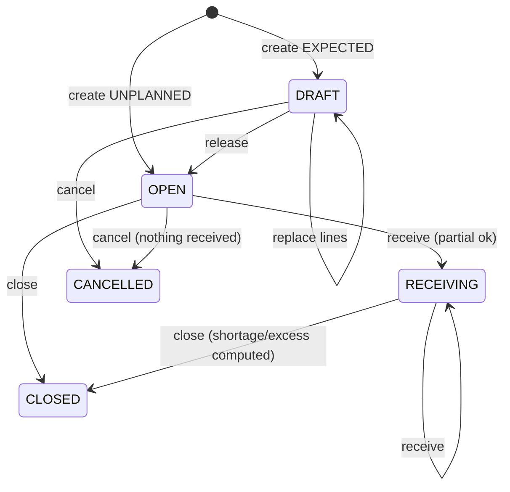
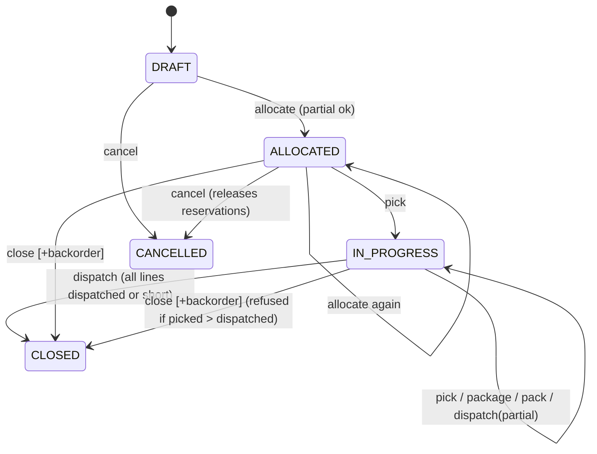
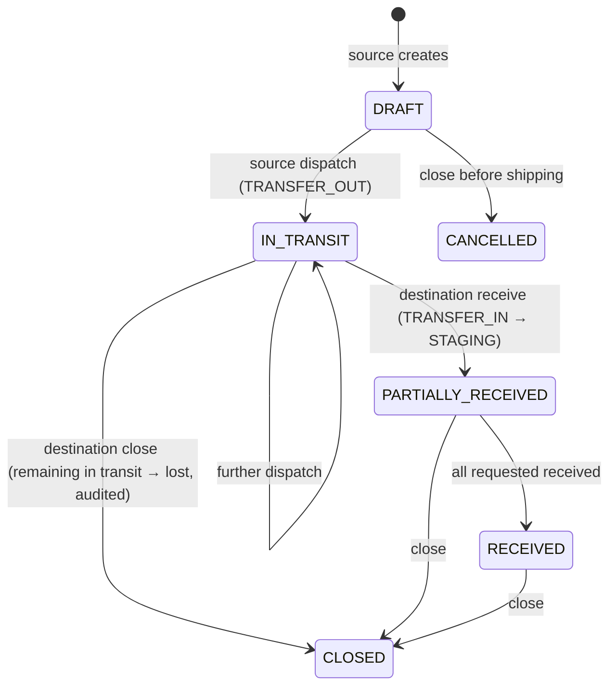

# WMS state machines and invariants — v0.5.0

Owning module: WMS. Each transition below is implemented in the named service and covered by
the tests listed in `docs/security/SECURITY_TEST_MATRIX.md`.

## Global invariants (tested)

| Id  | Invariant                                                       | Enforcement                                                       |
| --- | --------------------------------------------------------------- | ----------------------------------------------------------------- |
| L1  | `qty_on_hand(position) = Σ ledger.qty_delta(position)`          | engine `applyDelta`; `reconcile()`; property test; restore verify |
| L2  | `0 ≤ qty_reserved ≤ qty_on_hand`; reserved only when AVAILABLE  | DB CHECKs                                                         |
| L3  | `qty_reserved(position) = Σ open ACTIVE reservations`           | outbound service; `reconcileReservations()`                       |
| L4  | No negative on-hand (v0.5 policy, not configurable)             | DB CHECK + engine pre-check                                       |
| L5  | Ledger/transactions/movements/audit are append-only             | triggers + grants                                                 |
| L6  | In-transit quantity lives only on transfer documents            | transfer service                                                  |
| L7  | A command with the same Idempotency-Key is applied at most once | `command_log` PK                                                  |

Stock statuses: `AVAILABLE` (allocatable only in SHELF/BIN/LOCATION holders), `RECEIVED`
(staging, awaiting putaway), `INSPECTION`, `QUARANTINE`, `DAMAGED`, `PICKED` (packing area or
inside a package).

## Inbound (`inbound.service.ts`)

Receive: GOOD → STAGING node, status RECEIVED, +putaway task; DAMAGED → QUARANTINE/INSPECTION
node, status DAMAGED. Barcode must match the SKU; unknown SKU on the document creates an
excess line. Lot required for LOT/SERIAL-tracked SKUs.

## Putaway

Task OPEN → (partial completes) → DONE. Each completion moves RECEIVED → AVAILABLE to a
SHELF/BIN/LOCATION node or an active non-package container. Suggestions: consolidate with
existing AVAILABLE positions of the SKU, then empty holders.

## Outbound (`outbound.service.ts`)

Line counters: `requested ≥ allocated + picked + short`; `picked ≥ packed ≥ dispatched`.
Pick: barcode verified; AVAILABLE(reserved) → PICKED at a DISPATCH node, consuming the
reservation; `closeShort` releases the rest and records it as short. Pack: PICKED at the
package's node → PICKED inside the PACKAGE container (+package line). Dispatch: package contents
leave stock (DISPATCH ledger), package → DISPATCHED. Internal dispatch note is **not** a fiscal
transport document (DL 147/2003 / AT communication is out of scope).

## Transfer (`transfer.service.ts`)

Each side acts only inside its own warehouse scope; documents expose warehouse codes and SKU
quantities only.

## Returns (`returns.service.ts`)

INSPECTION → (dispositions, partial) → CLOSED when every unit has a disposition.
SALEABLE → AVAILABLE in SHELF/BIN/LOCATION; QUARANTINE → QUARANTINE node; DAMAGED → DAMAGED
in QUARANTINE/INSPECTION; SCRAP → written off (ledger negative).

## Counts (`count.service.ts`)

```mermaid
stateDiagram-v2
  [*] --> OPEN: create (snapshot qty + version)
  OPEN --> OPEN: record / found
  OPEN --> SUBMITTED: submit (all counted; stale lines flagged)
  SUBMITTED --> OPEN: recount line (re-snapshot)
  SUBMITTED --> APPROVED: approve (different user, wms.count.approve, step-up MFA)
  OPEN --> CANCELLED
  SUBMITTED --> CANCELLED
```

Policy: no freeze; optimistic version check. Approval posts `COUNT_ADJUST` deltas
(counted − current), refuses stale lines and adjustments below reserved quantity.

## Reservations

ACTIVE (`qty_open > 0`) → CLOSED (picked fully, short-closed, order cancelled/closed).

## Corrections

- Drafts (inbound/outbound) can be edited/cancelled.
- Posted work: `REVERSAL` for OPENING, MOVE, ADJUST, REPLENISH, CONTAINER_MOVE (once, audited);
  `ADJUST` with reason + step-up; otherwise a compensating move/return. History is never deleted.

## Replenishment

Rule (sku, pick node, min, target). When pick-node AVAILABLE < min → suggest moves from other
AVAILABLE positions up to target; if insufficient, a non-financial purchase suggestion.
