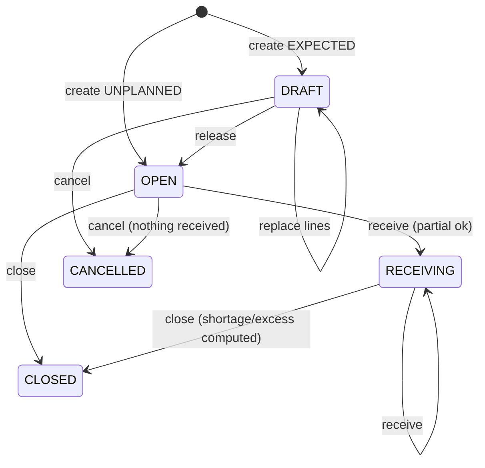
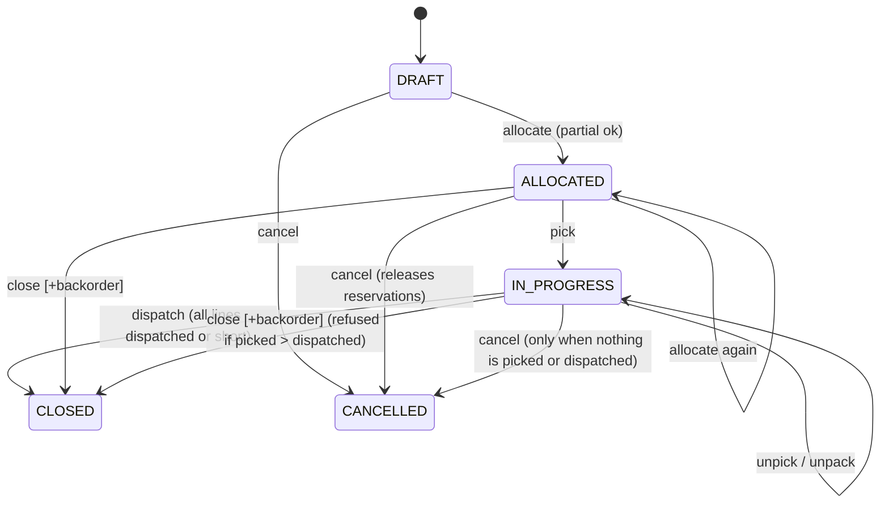
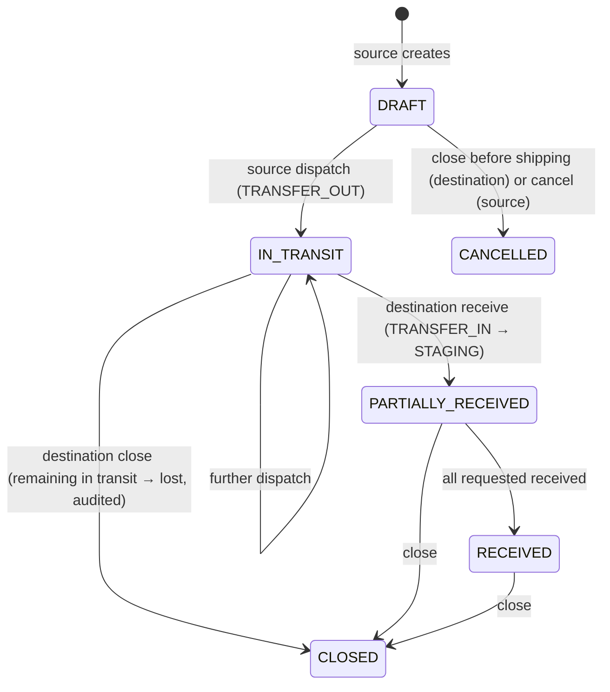

# WMS state machines and invariants — v0.6.6

Owning module: WMS. Each transition below is implemented in the named service and covered by
the tests listed in `docs/security/SECURITY_TEST_MATRIX.md`.

## Global invariants (tested)

| Id  | Invariant                                                       | Enforcement                                                       |
| --- | --------------------------------------------------------------- | ----------------------------------------------------------------- |
| L1  | `qty_on_hand(position) = Σ ledger.qty_delta(position)`          | engine `applyDelta`; `reconcile()`; property test; restore verify |
| L2  | `0 ≤ qty_reserved ≤ qty_on_hand`; reserved only when AVAILABLE  | DB CHECKs                                                         |
| L3  | `qty_reserved(position) = Σ open ACTIVE reservations`           | outbound service; `reconcileReservations()`                       |
| L4  | No negative on-hand (v0.5 policy, not configurable)             | DB CHECK + engine pre-check                                       |
| L5  | Ledger/transactions/movements/audit are append-only             | triggers + grants                                                 |
| L6  | In-transit quantity lives only on transfer documents            | transfer service                                                  |
| L7  | A command with the same Idempotency-Key is applied at most once | `command_log` PK                                                  |

Stock statuses: `AVAILABLE` (allocatable only in SHELF/BIN/LOCATION holders), `RECEIVED`
(staging, awaiting putaway), `INSPECTION`, `QUARANTINE`, `DAMAGED`, `PICKED` (packing area or
inside a package).

## Inbound (`inbound.service.ts`)

Receive: GOOD → STAGING node, status RECEIVED, +putaway task; DAMAGED → QUARANTINE/INSPECTION
node, status DAMAGED. Barcode must match the SKU; unknown SKU on the document creates an
excess line. Lot required for LOT/SERIAL-tracked SKUs.

## Putaway

Task OPEN → (partial completes) → DONE. Each completion moves RECEIVED → AVAILABLE to a
SHELF/BIN/LOCATION node or an active non-package container. Suggestions: consolidate with
existing AVAILABLE positions of the SKU, then empty holders.

## Outbound (`outbound.service.ts`)

Line counters: `requested ≥ allocated + picked + short`; `picked ≥ packed ≥ dispatched`.
Pick: barcode verified; AVAILABLE(reserved) → PICKED at a DISPATCH node, consuming the
reservation; `closeShort` releases the rest and records it as short. Pack: PICKED at the
package's node → PICKED inside the PACKAGE container (+package line). Dispatch: package contents
leave stock (DISPATCH ledger), package → DISPATCHED. Scans count packs of the scanned barcode's
`qty_per_uom` (case of 12 → 12 base units). Un-pick (`UNPICK`): picked units not in a package go
from a DISPATCH node back to SHELF/BIN/LOCATION as AVAILABLE, lot preserved, `picked` decreases.
Un-pack (`UNPACK`): packed, undispatched units leave the package back to its DISPATCH node as
PICKED; `packed` decreases and `outbound_package_lines.qty_unpacked` records it. Cancel and close
mark the order's empty ACTIVE packages CLOSED (refused if a package still holds stock). Internal
dispatch note is **not** a fiscal
transport document (DL 147/2003 / AT communication is out of scope).

## Transfer (`transfer.service.ts`)

Each side acts only inside its own warehouse scope; documents expose warehouse codes, SKU
quantities and lot codes only. Lots: dispatch records the source position's lot in
`transfer_line_lots`; receipt takes the requested lot, or else lots in ascending lot-code order,
creating one RECEIVED position and putaway task per lot; close records the remaining in-transit
quantity as lost per lot.

**Source reservations (v0.6.3, ADR-0025).** In DRAFT or IN_TRANSIT the source may _allocate_:
reservations with `transfer_line_id` hold `requested − shipped − reserved` per line (FEFO),
so outbound allocation cannot take that stock. Dispatch consumes the line's reservation on the
chosen position first; a fully shipped line releases leftovers; cancel releases all. Invariant:
`transfer_lines.qty_reserved = Σ active reservations.qty_open` for the line. The destination
cannot close while `Σ qty_reserved > 0` (`TRANSFER_RESERVED`).

## Returns (`returns.service.ts`)

INSPECTION → (dispositions, partial) → CLOSED when every unit has a disposition.
SALEABLE → AVAILABLE in SHELF/BIN/LOCATION; QUARANTINE → QUARANTINE node; DAMAGED → DAMAGED
in QUARANTINE/INSPECTION; SCRAP → written off (ledger negative).

## Counts (`count.service.ts`)

```mermaid
stateDiagram-v2
  [*] --> OPEN: create (snapshot qty + version)
  OPEN --> OPEN: record / found
  OPEN --> SUBMITTED: submit (all counted; stale lines flagged)
  SUBMITTED --> OPEN: recount line (re-snapshot)
  SUBMITTED --> APPROVED: approve (different user, wms.count.approve, step-up MFA)
  OPEN --> CANCELLED
  SUBMITTED --> CANCELLED
```

Policy: no freeze; optimistic version check. Approval posts `COUNT_ADJUST` deltas
(counted − current), refuses stale lines and adjustments below reserved quantity.

## Stock quality status (`stock.service.ts changeStatus`)

AVAILABLE ⇄ QUARANTINE / DAMAGED / INSPECTION for **free** (unreserved) quantity only, posted as
`STATUS_CHANGE` (lot preserved, optional move). Blocking needs `wms.adjust`; releasing to
AVAILABLE also needs step-up and an allocatable destination (SHELF/BIN/LOCATION) so released stock
is never stranded in a quarantine area. Both directions are written to the security audit log.
RECEIVED and PICKED stock are in process and cannot change status here.

## Topology lifecycle

Nodes: rename (code immutable — printed on labels); deactivate applies to the whole subtree and is
refused while any node in it holds stock or an ACTIVE container; inactive nodes reject every
stock operation and child creation; reactivation is top-down. Containers: ACTIVE → CLOSED when
empty (packages close with their order); CLOSED containers cannot hold stock or move.

## Lots, expiry and serials (ADR-0024)

Allocation order: earliest expiry first (FEFO), expired lots never allocated, undated lots last;
then lot code ascending; then fullest free quantity. A line may request one lot. Serial-tracked
SKUs: 1 unit per serial position and one on-hand position per serial per company (database
trigger), and a serial in transit cannot be received elsewhere.

## Reservations

ACTIVE (`qty_open > 0`) → CLOSED (picked fully, short-closed, order cancelled/closed; for
transfer reservations: dispatched, line fully shipped, transfer cancelled). Each reservation
belongs to exactly one demand line (`reservations_one_demand`).

## Corrections

- Drafts (inbound/outbound) can be edited/cancelled.
- Posted work: `REVERSAL` for OPENING, MOVE, ADJUST, REPLENISH, CONTAINER_MOVE (once, audited,
  `wms.adjust` + step-up, refused if it would drive a position negative); `ADJUST` with reason +
  step-up; otherwise a compensating move/return/un-pick. History is never deleted.

## Replenishment

Rule (sku, pick node, min, target). When pick-node AVAILABLE < min → suggest moves from other
AVAILABLE positions up to target; if insufficient, a non-financial purchase suggestion.
