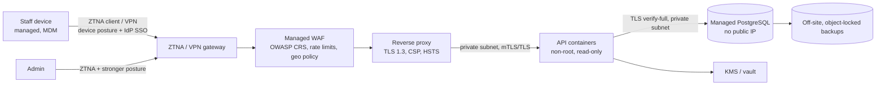

# Production network reference architecture — NOT DEPLOYED / UNVERIFIED

Owning module: operations/security. No cloud account or network was available or used in this
build. Every control below is **NOT DEPLOYED / UNVERIFIED** until an environment is configured and
the verification steps are executed and recorded.

## Requirements

1. **No public, unauthenticated ERP login.** The application is reachable only through ZTNA/VPN
   for warehouse operations **and** administration. ZTNA does not replace application MFA.
2. WAF in front of the proxy with OWASP Core Rule Set (paranoia ≥ 2 after tuning), request
   size limits aligned with the API (256 KB JSON, 1 MB CSV), bot/rate rules on `/api/auth/*`.
3. Reverse proxy: `infra/nginx/autolemon.conf` (TLS 1.3, HSTS, CSP without `unsafe-inline`,
   security headers). API `TRUST_PROXY` lists only the proxy addresses (never `true`).
4. Network segmentation: edge / app / data subnets; DB only reachable from the app subnet and the
   backup host; admin/internal endpoints not routable from the Internet.
5. Restricted egress: API needs DB + KMS only (no Internet). Package downloads happen in CI.
6. Containers: non-root, read-only rootfs, `no-new-privileges`, dropped capabilities, resource
   limits, health checks (`Dockerfile`, `infra/compose/docker-compose.prod.example.yml`).
7. Secrets provisioned from the vault at deploy time; least-privilege runtime identities
   (`autolemon_app` DB role; KMS encrypt/decrypt-only role).
8. Patching: OS/base images weekly, dependencies per `docs/DEPENDENCIES.md` policy.

## Verification checklist (record evidence in `docs/PROJECT_STATE.md` when executed)

| Control       | How to verify                                                                            | Status          |
| ------------- | ---------------------------------------------------------------------------------------- | --------------- |
| ZTNA required | From outside ZTNA: DNS resolves only internal or app unreachable; from inside: reachable | NOT DEPLOYED    |
| WAF active    | Send OWASP CRS test payloads (staging) → blocked & logged                                | NOT DEPLOYED    |
| TLS 1.3       | `testssl.sh` / `openssl s_client -tls1_2` refused (or documented exception)              | NOT DEPLOYED    |
| DB private    | No public IP; port scan from Internet fails; `sslmode=verify-full` from app              | NOT DEPLOYED    |
| KMS           | `KEY_PROVIDER=external-kms` implemented and app starts; key policy reviewed              | NOT IMPLEMENTED |
| Egress        | Outbound HTTP from API container to Internet fails                                       | NOT DEPLOYED    |
| Monitoring    | Alerts in AUDIT_LOGGING.md §5 fire in a drill                                            | NOT DEPLOYED    |
